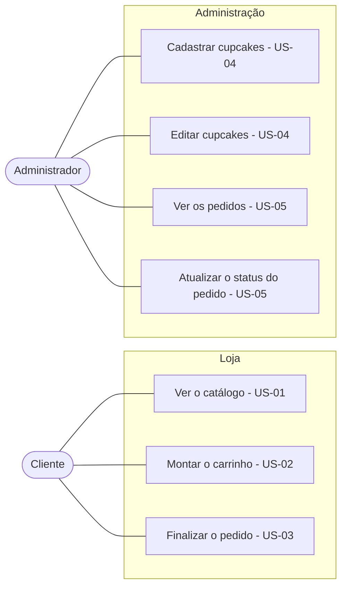
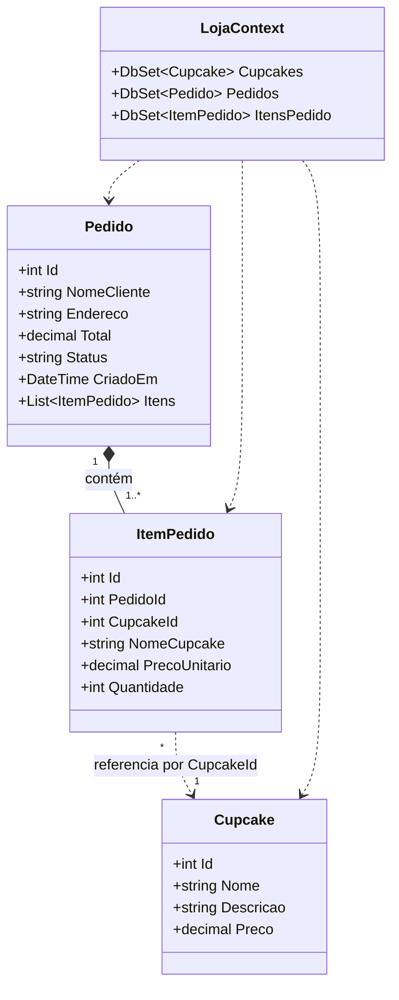
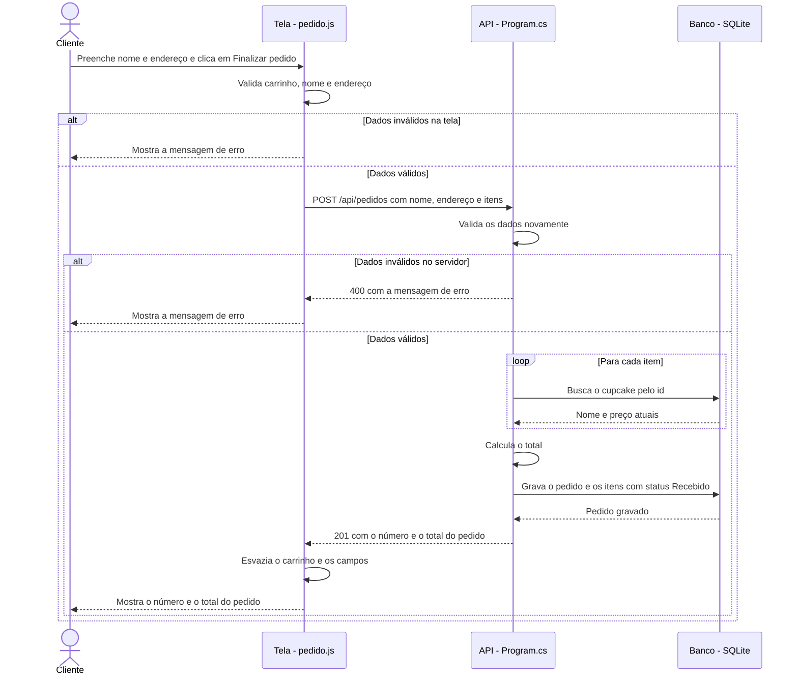
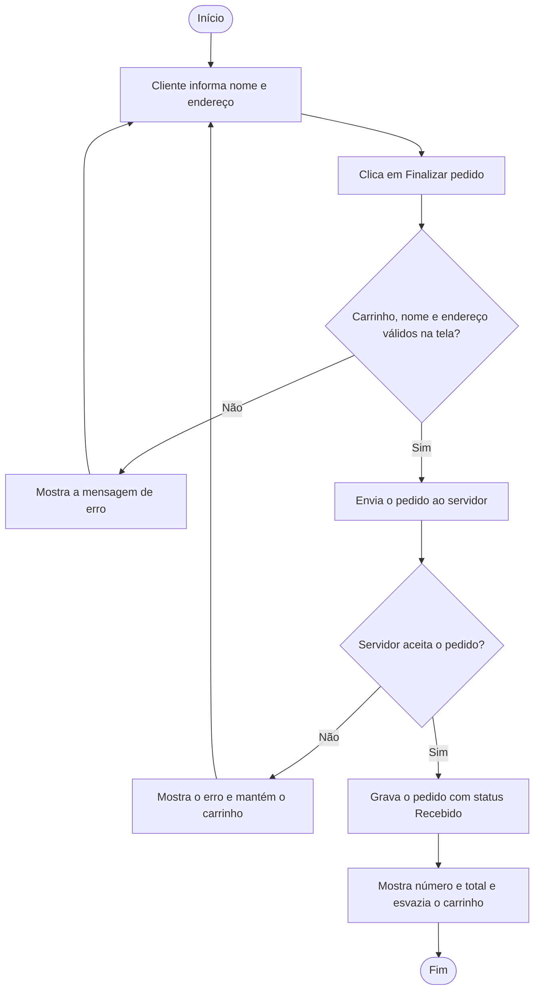

# Diagramas — Cupcakeria

Modelagem do sistema alinhada ao que foi implementado. Os diagramas são escritos em [Mermaid](https://mermaid.js.org/), que o GitHub desenha automaticamente ao abrir este arquivo.

## 1. Casos de uso (visão geral)

Os dois atores do sistema e o que cada um faz. Cada caso de uso corresponde a uma história de usuário (ver `historias-de-usuario.md`).

## 2. Caso de uso expandido: Finalizar o pedido

- **Nome:** Finalizar o pedido
- **Identificador:** UC-03 (história US-03)
- **Descrição:** o cliente envia o carrinho, com nome e endereço, e o sistema grava o pedido.
- **Pré-condições:** o carrinho tem pelo menos um cupcake.
- **Pós-condições:** o pedido fica gravado com o status "Recebido" e o carrinho fica vazio.

**Curso básico de ação**

1. O caso de uso começa quando o cliente deseja finalizar a compra.
2. O sistema exibe o carrinho, com itens, quantidades e total.
3. O cliente informa o nome e o endereço de entrega.
4. O cliente clica em "Finalizar pedido".
5. O sistema valida o carrinho, o nome e o endereço na tela. `<Curso alternativo Alfa>`
6. O sistema envia ao servidor apenas o nome, o endereço e, para cada item, o cupcake e a quantidade.
7. O servidor valida os dados novamente e consulta os preços atuais no banco (US-03, RN#1 e RN#5). `<Curso alternativo Beta>`
8. O servidor calcula o total e grava o pedido com o status "Recebido" (US-03, RN#2, RN#3 e RN#4).
9. O sistema informa o número e o total do pedido e esvazia o carrinho e os campos.
10. O caso de uso termina.

**Curso alternativo Alfa:** dados inválidos na tela.

- Alfa5: o sistema mostra a mensagem correspondente ("Seu carrinho está vazio.", "Informe o seu nome." ou "Informe o endereço de entrega.").
- Alfa6: o caso de uso volta ao passo 3 e nada é enviado ao servidor.

**Curso alternativo Beta:** o servidor recusa o pedido ou ocorre falha de conexão.

- Beta7: o sistema mostra a mensagem de erro recebida ou "Erro de conexão. Tente novamente.".
- Beta8: o carrinho é mantido e o caso de uso volta ao passo 3.

## 3. Diagrama de classes

Classes do modelo, que viram as tabelas do banco SQLite, e o `LojaContext`, que faz a ligação com o banco.

**Observações sobre o modelo**

- Um `Pedido` é composto por um ou mais `ItemPedido`: sem o pedido, os itens não existem.
- O `ItemPedido` guarda o `NomeCupcake` e o `PrecoUnitario` **do momento da compra**. Por isso, editar um cupcake depois não altera pedidos antigos.
- A ligação entre `ItemPedido` e `Cupcake` é só pelo `CupcakeId`, sem relacionamento direto no código.
- O `Status` pode ser "Recebido", "Em preparo" ou "Entregue".

## 4. Diagrama de sequência: Finalizar o pedido

Fluxo do caso de uso UC-03, com o caminho normal e os caminhos de erro.

**Diagrama de atividades**

